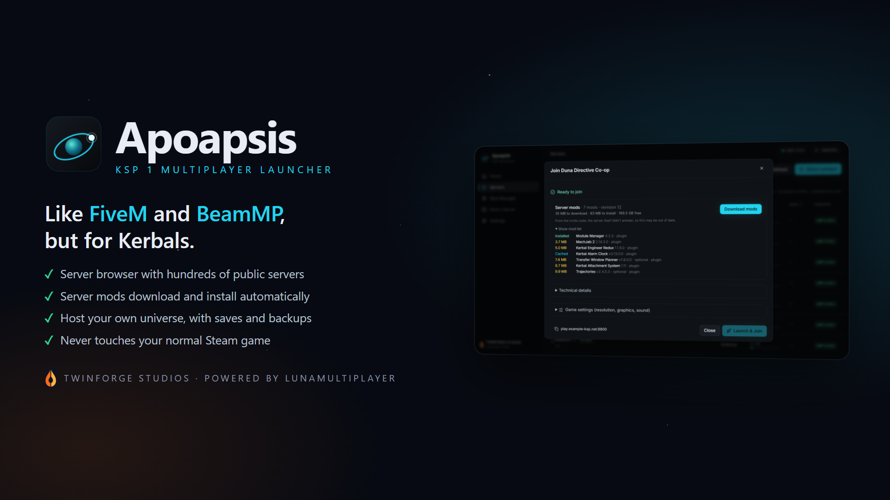
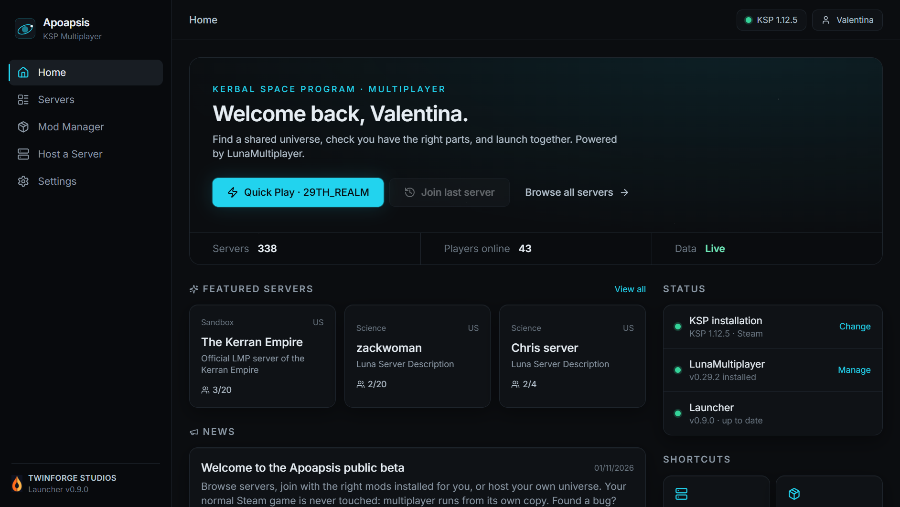
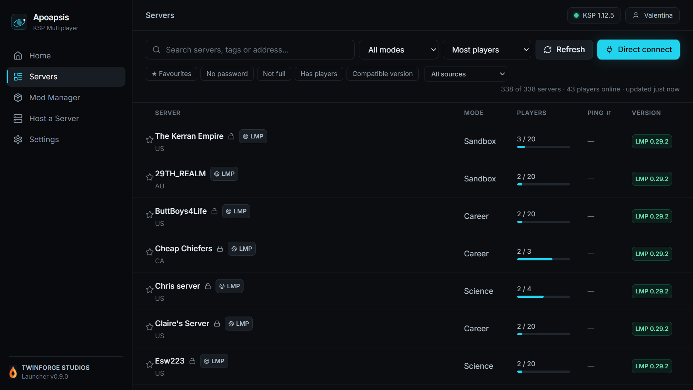
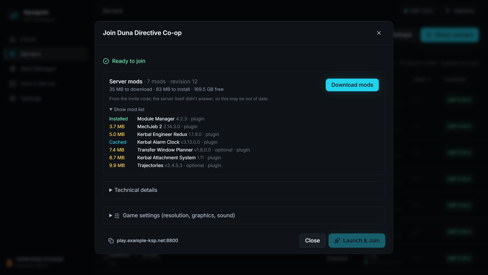
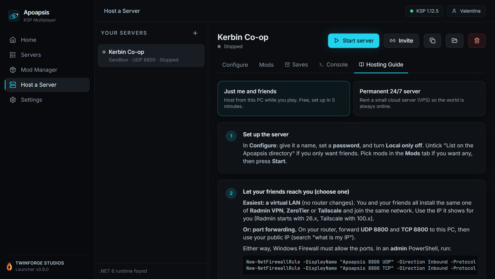
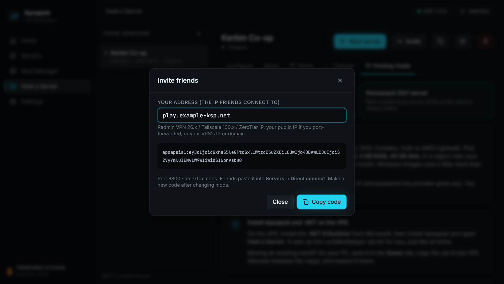
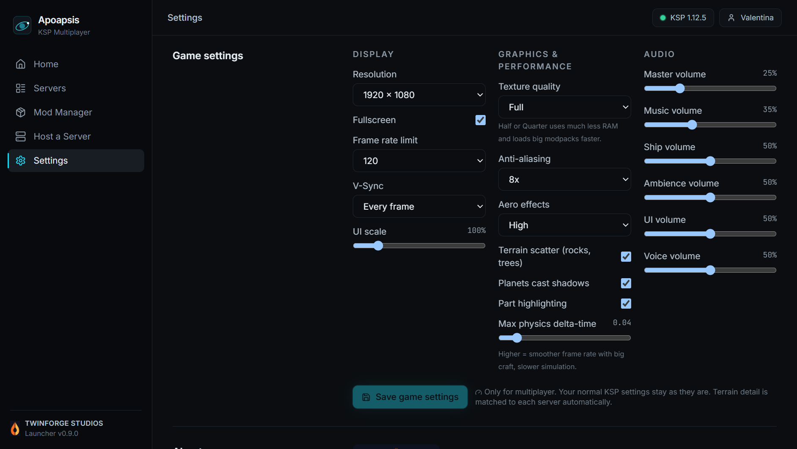

<b>One-click multiplayer for Kerbal Space Program.</b> 
Like FiveM for GTA or BeamMP for BeamNG, built on <a href="https://github.com/LunaMultiplayer/LunaMultiplayer">LunaMultiplayer</a>.

<a href="https://github.com/dll1230/Apoapsis-one-click-KSP-multiplayer/releases/latest"><b>⬇ Download the latest version</b></a> ·
<a href="https://discord.gg/yPf4jnb4yv"><b>Discord</b></a> ·
<a href="https://github.com/dll1230/Apoapsis-one-click-KSP-multiplayer/wiki"><b>Wiki</b></a>

## What it does

- **Server browser:** hundreds of public LunaMultiplayer servers with players, game mode, password and ping. The list refreshes live.
- **One-click join:** KSP starts and auto-joins straight into the server's Space Centre, skipping the main menu.
- **Server mods installed for you:** hosts pick their mods from CKAN, and players get the exact versions automatically when they join (SHA-256 verified).
- **Your Steam game stays untouched:** multiplayer runs from a separate copy, and your normal install is only ever read.
- **Host from the launcher:** run your own servers, with guides for playing with friends or running a 24/7 VPS.
- **Invite codes:** one code carries your address *and* your mod list.
- **Discord status:** your friends see you're playing Apoapsis, and on which server.

## Screenshots

<table>
<tr>
<td width="50%"> <b>Home:</b> Quick Play, your last server and news</td>
<td width="50%"> <b>Server browser:</b> live public servers with players and ping</td>
</tr>
<tr>
<td> <b>Join:</b> the server's mods are downloaded and installed for you</td>
<td> <b>Host:</b> step-by-step guides for friends or a 24/7 server</td>
</tr>
<tr>
<td> <b>Invite codes:</b> share your address and mod list in one code</td>
<td> <b>Game settings:</b> graphics and audio for the multiplayer copy</td>
</tr>
</table>

## Install

1. Open [Releases](https://github.com/dll1230/Apoapsis-one-click-KSP-multiplayer/releases/latest) and download `Apoapsis-x.y.z-Windows.zip`.
2. Extract it and run `Apoapsis_x.y.z_x64-setup.exe`. Windows may warn because the installer isn't code-signed yet: click **More info → Run anyway**.
3. Pick your player name and your KSP folder, then join a server.

Requires Windows 10/11 (64-bit) and KSP 1.12.x. **This is a launcher, not a GameData mod:** don't put anything in GameData.

## Help and bug reports

Read the [wiki](https://github.com/dll1230/Apoapsis-one-click-KSP-multiplayer/wiki), join the [Discord](https://discord.gg/yPf4jnb4yv) or open an [issue](https://github.com/dll1230/Apoapsis-one-click-KSP-multiplayer/issues/new/choose). Please attach the zip from *Settings → Logging & diagnostics → Create bug report*.

## Licence

Apoapsis © 2026 Twinforge Studios. **Freeware, all rights reserved:** free to download and use, but please don't re-upload, sell or modify it. This repository hosts releases only; the source code is not public.

Multiplayer is powered by [LunaMultiplayer](https://github.com/LunaMultiplayer/LunaMultiplayer) (MIT, © Gabriel Vazquez and contributors). Kerbal Space Program is a trademark of Take-Two Interactive. Apoapsis is an unofficial project.
